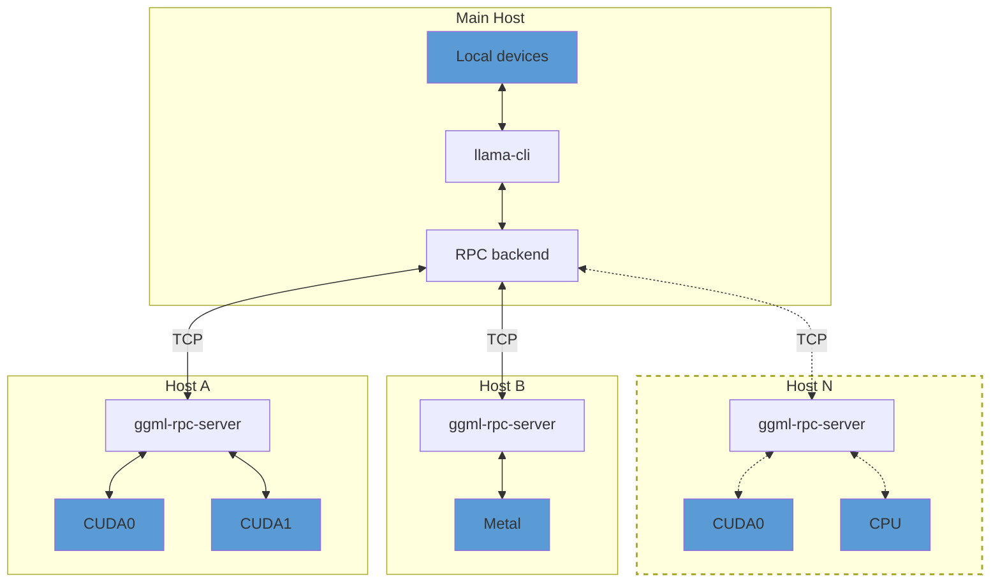

## Overview

> [!IMPORTANT]
> This example and the RPC backend are currently in a proof-of-concept development stage. As such, the functionality is fragile and
> insecure. **Never run the RPC server on an open network or in a sensitive environment!**

The `ggml-rpc-server` allows exposing `ggml` devices on a remote host.
The RPC backend communicates with one or several instances of `ggml-rpc-server` and offloads computations to them.
This can be used for distributed LLM inference with `llama.cpp` in the following way:



By default, `ggml-rpc-server` exposes all available accelerator devices on the host.
If there are no accelerators, it exposes a single `CPU` device.

## Usage

### Remote hosts

On each remote host, build the backends for each accelerator by adding `-DGGML_RPC=ON` to the build options.
For example, to build the `ggml-rpc-server` with support for CUDA accelerators:

```bash
mkdir build-rpc-cuda
cd build-rpc-cuda
cmake .. -DGGML_CUDA=ON -DGGML_RPC=ON
cmake --build . --config Release
```

When started, the `ggml-rpc-server` will detect and expose all available `CUDA` devices:

```bash
$ bin/ggml-rpc-server
ggml_cuda_init: GGML_CUDA_FORCE_MMQ:    no
ggml_cuda_init: GGML_CUDA_FORCE_CUBLAS: no
ggml_cuda_init: found 1 CUDA devices:
  Device 0: NVIDIA GeForce RTX 5090, compute capability 12.0, VMM: yes
Starting RPC server v3.0.0
  endpoint       : 127.0.0.1:50052
  local cache    : n/a
Devices:
  CUDA0: NVIDIA GeForce RTX 5090 (32109 MiB, 31588 MiB free)
```

You can control the set of exposed CUDA devices with the `CUDA_VISIBLE_DEVICES` environment variable or the `--device` command line option. The following two commands have the same effect:
```bash
$ CUDA_VISIBLE_DEVICES=0 bin/ggml-rpc-server -p 50052
$ bin/ggml-rpc-server --device CUDA0 -p 50052
```

### Main host

On the main host build `llama.cpp` with the backends for the local devices and add `-DGGML_RPC=ON` to the build options.
Finally, when running `llama-cli` or `llama-server`, use the `--rpc` option to specify the host and port of each `ggml-rpc-server`:

```bash
$ llama-cli -hf ggml-org/gemma-3-1b-it-GGUF -ngl 99 --rpc 192.168.88.10:50052,192.168.88.11:50052
```

By default, llama.cpp distributes model weights and the KV cache across all available devices -- both local and remote -- in proportion to each device's available memory.
You can override this behavior with the `--tensor-split` option and set custom proportions when splitting tensor data across devices.

### Local cache

The RPC server can use a local cache to store large tensors and avoid transferring them over the network.
This can speed up model loading significantly, especially when using large models.
To enable the cache, use the `-c` option:

```bash
$ bin/ggml-rpc-server -c
```

By default, the cache is stored in the `$HOME/.cache/llama.cpp/rpc` directory and can be controlled via the `LLAMA_CACHE` environment variable.

### Tensor-split networking in llama.cpp-opencl

Server-to-server connections are disabled by default, even for clients with `GGML_RPC_TOKEN`. To enable the communicator used by `-sm tensor`, set `GGML_RPC_COMM_ENDPOINT` on every participating RPC server to the **same** rank-zero IPv4 literal and port. The address must be reachable by the other servers and bindable by rank zero; the port must equal the first RPC endpoint's port plus 1000. DNS names, wildcard addresses, malformed ports and client requests for a different endpoint are rejected.

For two local devices with the first RPC endpoint at `127.0.0.1:50052`, start both servers with `GGML_RPC_COMM_ENDPOINT=127.0.0.1:51052`. For different computers, use rank zero's LAN IP instead. Rank zero listens only on that address; no communicator listener is opened on `0.0.0.0`. Use the same `GGML_RPC_TOKEN` on all peers and the client when authentication is enabled. Ordinary layer splitting does not require a communicator.

The HELLO feature byte announces when the communicator is disabled, so updated clients avoid starting an unavailable communicator. Older clients still receive a failed COMM_INIT response. The wire layouts and command numbers are unchanged. Communicators accept at most 16 ranks; this fork's CPU/OpenCL pairwise reduction still supports only two. Waiting for a peer and authenticating it have 10-second limits.

### Protocol memory bounds in llama.cpp-opencl

Graph frames are limited to 64 MiB, and SUPPORTS_OP frames to the maximum number of tensors in that command. These limits are checked before a receive buffer is allocated. Tensor uploads keep their existing wire format and can exceed 64 MiB: the server first validates the tensor, ownership, offsets and complete span, then receives in chunks of at most 16 MiB. Two-dimensional uploads also validate their count, payload size and stride without overflowing.

With `--cache`, uploads are hashed incrementally and spooled through a private temporary file, then copied to their usual hash-named cache file after the complete upload. The temporary file is closed and removed on failure. Cache writes need temporary disk space as well as the final cache space; a temporary-file failure skips caching without invalidating the upload. These are receive-buffer limits, not quotas for device memory, graph caches, execution time or all RPC responses.

### RDMA transport

The RPC backend can use RDMA instead of TCP for lower latency and higher throughput. The transport is negotiated during the initial handshake -- no changes to command-line usage are required, and the connection falls back to TCP unless both peers can use RDMA.

Two providers are supported, each enabled by default when its library is found at build time:

- **Linux**: RoCEv2-capable NICs (e.g. Mellanox ConnectX), via `libibverbs`.
- **macOS**: RDMA over Thunderbolt on Apple silicon Macs with Thunderbolt 5, via `librdma`. Requires macOS 26.2 or later, with RDMA enabled once from macOS Recovery via `rdma_ctl enable`. See [TN3205](https://developer.apple.com/documentation/technotes/tn3205-low-latency-communication-with-rdma-over-thunderbolt).

RDMA is point-to-point, so each side uses the local device whose GID matches the address the connection was made on. Connect over the RDMA-capable link -- with Thunderbolt, use the peer's Thunderbolt address in `--rpc`; a connection made over another interface stays on TCP.

To force plain TCP without rebuilding, set `GGML_RPC_NO_RDMA` on either peer:
```bash
$ GGML_RPC_NO_RDMA=1 bin/ggml-rpc-server
```

### Troubleshooting

The `GGML_RPC_DEBUG` environment variable controls the verbosity of the logs emitted by the RPC backend.
It can be set on the server, on the client (e.g. `llama-cli`), or both. Larger values produce more detailed output:

- unset / `0` - disabled (only warnings and errors are printed)
- `1` - high-level events: connections, handshake, buffer allocations, graph computes, cache evictions
- `2` - per-command trace: every RPC message sent/received, tensor transfers, cache hits/misses
- `3` - fine detail: per-command timings, graph node dumps, transport byte counts

Non-numeric values are treated as `1`.

```bash
$ GGML_RPC_DEBUG=1 bin/ggml-rpc-server
```

> [!NOTE]
> The debug levels are emitted as `ggml` debug records, which `llama.cpp` applications drop unless the
> global verbosity threshold is raised. On the client, pass `-lv 5` together with `GGML_RPC_DEBUG`:

```bash
$ GGML_RPC_DEBUG=2 bin/llama-cli -hf ggml-org/gemma-3-1b-it-GGUF -ngl 99 --rpc 192.168.88.10:50052 -lv 5
```

